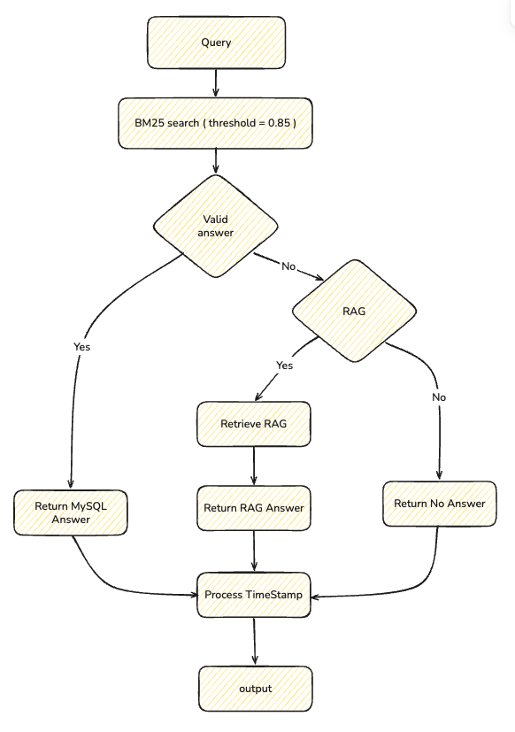
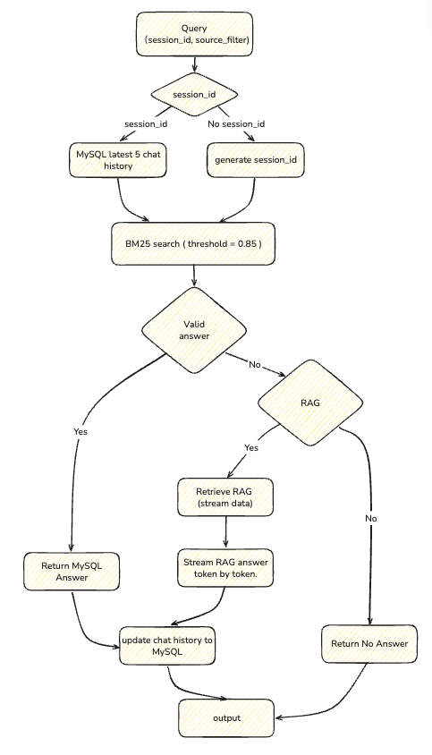

# Insurance RAG Assistant — integrations

## Version 1:
 Blocking CLI. BM25 → RAG. Full answer, no stream
<p></p>

```bash
python main_integration.py
```

Sources: `clause` / `medical` / `case` (Enter = no filter). Type `exit` to quit.

## Version 2: MySQL history + token stream
 Version 2 changes both: the last 5 turns sit in MySQL under a `session_id`, and the final LLM call streams tokens to the terminal as they arrive.
<p></p>

```bash
python integrated_qa_system/main_history_stream_version.py
```

Code:

- `integrated_qa_system/main_history_stream_version.py`
- `integrated_qa_system/rag_qa/core/new_rag_system.py`
- `RAGPrompts.rag_prompt_with_history()` in `prompts.py`

```text
question
  → Redis exact cache → return
  → BM25 vs MySQL (threshold 0.85)
        hit  → cache, return canned answer
        miss → RAGSystem.generate_answer
                 BERT general_inquiry → LLM, no retrieve
                 BERT claims_adjudication → retrieve + generate
```

Each question does four things with history:

1. **Load.** `_fetch_recent_history(session_id)` selects the latest 5 rows `ORDER BY timestamp DESC`, then reverses them so the prompt sees chronological order: `[{question, answer}, ...]`.
2. **Fill the prompt.** `new_rag_system.generate_answer(..., history=history)` keeps at most 5 valid dicts and joins them as `Q: ...\nA: ...`. That string is `{history}` in `rag_prompt_with_history()`. Retrieval still uses the current question (or a HyDE / sub-query / backtracking rewrite), not the chat log.
3. **Write.** After a BM25 hit or after the RAG stream finishes, `update_session_history` inserts the new turn with `NOW()`.
4. **Trim.** A nested `DELETE ... id NOT IN (latest 5 ids)` drops older rows for that session only. The nested subquery is required by MySQL (you cannot delete from the same table you select in one level).

BM25 canned answers and RAG opinions both land in the same table, so follow-up questions see the last turn either way. `clear_session_history(session_id)` wipes the session.

This is complementary to §6, not a replacement of LangGraph in Version 1: MySQL survives restart; the window is a hard 5 turns with no summary compression.

```text
session_id (uuid)
  → SELECT last 5 turns (DESC, then reverse)
  → history_context = "Q: ...\nA: ..."
  → RAG prompt {history} + {context} + {question}
  → INSERT new turn
  → DELETE rows beyond the latest 5 for this session
```

### Stream: `stream=True` on the final opinion only

The LLM callable passed into `RAGSystem` is `call_dashscope`: OpenAI-compatible chat completions with `stream=True`. Each SSE chunk yields `delta.content` if present.

`generate_answer` itself is a generator. `IntegratedQASystem.query` maps that onto `(token, is_complete)`:

```text
question
  → load MySQL history
  → BM25 (threshold 0.85)
        hit  → yield (full_answer, True), then persist history
        miss → for token in RAGSystem.generate_answer(..., history):
                   yield (token, False)     # print immediately, flush
               persist concatenated answer
               yield ("", True)             # end of stream
```

---
