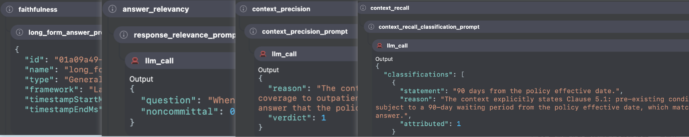
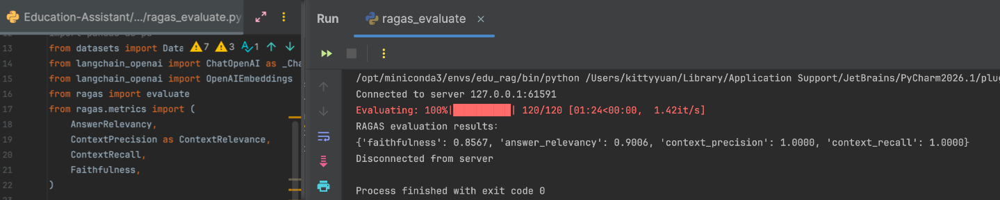

# Insurance RAG Assistant — retrieval notes

Online traffic is not “embed the question and return top-k”. I first classify whether this is claims adjudication, then pick a claims scene and a retrieval strategy, search clause / medical / case files, and generate a cited first-pass opinion from the parent context plus per-case history.

Code:

- `integrated_qa_system/rag_qa/core/query_classifier.py`
- `integrated_qa_system/rag_qa/core/strategy_selector.py`
- `integrated_qa_system/rag_qa/core/prompts.py`
- `integrated_qa_system/rag_qa/core/memory.py` (Version 1 in-process history)
- `integrated_qa_system/rag_qa/core/rag_system.py` (Version 1 blocking generate)
- `integrated_qa_system/rag_qa/core/new_rag_system.py` (Version 2 history + stream)
- `integrated_qa_system/main_history_stream_version.py` (Version 2 CLI)
- `integrated_qa_system/rag_qa/core/document_processor.py`
- `integrated_qa_system/rag_qa/core/vector_store.py`
- `integrated_qa_system/rag_qa/edu_text_spliter/`
- `integrated_qa_system/rag_qa/edu_document_loaders/`

<p></p>

---

## 1. Ingest: files → Document

`document_processor.load_documents_from_directory` walks the tree. Folder name `clause_data` becomes metadata `source = clause`. That field is the later filter (`clause` / `medical` / `case`).

Every successful load also sets:

- `file_path`
- `timestamp` (ISO)

A failed file logs an error and the rest of the directory still runs. One bad scan should not kill a whole corpus dump.

OCR is a fallback, not multimodal understanding. Blurry bills produce dirty text; dirty text poisons recall.
<p></p>
---

## 2. Chunk: parent / child, not one window

`process_documents` splits parents first, then children. Each child keeps the full parent:

```text
- parent_chunk_size = **1200**
- child_chunk_size = **300**
- chunk_overlap = **50**
- retrieval_k = **5** (hybrid search returns 5 children)
- candidate_m = **2** (at most 2 parents after rerank)
```

What gets indexed is the child. After a hit, `parent_content` rebuilds the parent; parents are deduped by that text.

Why I chose these sizes:

- Child 300: sharper vectors. Clause numbers, deductibles, and headings are easier for hybrid search to hit.
- Parent 1200: rerank (and later generation) see a full subsection, not half a sentence — required for legal completeness.
- Overlap 50: sentences on the window edge still line up across adjacent children.

`.md` uses `MarkdownTextSplitter`. Everything else uses `EduRecursiveTextSplitter`. The recursive splitter walks paragraph → sentence → clause → comma until something actually cuts, then collapses extra blank lines. Separators stay in the chunk (`keep_separator=True`), so sentence punctuation is not stripped.

`AliTextSplitter` is in the package and not wired into the main path. Semantic splits follow paragraph boundaries better, but they pull in a BERT and are slow on CPU. Claims files currently use rule-based splits; semantic split is a spare option.
<p></p>
---

## 3. Index: BGE-M3 + two vector fields in Milvus

Collection: `edurag.edurag_final` (Insurance RAG Assistant vector store). The database is created if missing.

Fields that actually affect retrieval:

| Field | Type | Use |
| --- | --- | --- |
| id | VARCHAR PK | child MD5 |
| text | VARCHAR | child body |
| dense_vector | FLOAT_VECTOR(1024) | BGE-M3 dense |
| sparse_vector | SPARSE_FLOAT_VECTOR | BGE-M3 term weights as `{index: weight}` |
| parent_id / parent_content | VARCHAR | rebuild parent after a hit |
| source | VARCHAR | `clause` / `medical` / `case` filter |
| timestamp | VARCHAR | provenance |

One BGE-M3 encode gives dense and sparse, so there is no separate BM25 corpus to keep in sync. Sparse index build drops the bottom 20% of weights; the inverted list is cleaner on function words in forms.

Writes go through `upsert`. Re-running `vector_store.py` on the same files overwrites identical children instead of appending.

On Mac MPS, embeddings default to fp16. Milvus FLOAT_VECTOR wants `float32`. `add_documents` does `np.asarray(..., dtype=np.float32)` and casts sparse index/value to Python `int` / `float`. That is a real type error, not a style choice.
<p></p>
---

## 4. Retrieve: hybrid → parent dedupe → CrossEncoder

`hybrid_search_with_rerank(query, k=5, source_filter=...)`:

1. Encode the query with BGE-M3 → dense + sparse.
2. Two `AnnSearchRequest`s share the same filter, e.g. `source == 'clause'`.
3. Milvus `hybrid_search` + `WeightedRanker(1.0, 0.7)`: dense owns semantics, sparse pulls the original term back.
4. Map children to parents; dedupe on `parent_content`. Several child hits in one section collapse to one parent.
5. Fewer than 2 parents: skip rerank, slice to `candidate_m`.
6. Otherwise `bge-reranker-large` scores `[query, parent_content]`, sort descending, keep Top-2.

Rerank runs on parents, not children. A CrossEncoder is more accurate than a bi-encoder and more expensive, so it only sees the short fused list, not the whole collection.

`vector_store.py` can ingest and then run a sample hybrid search. Generation consumes the same parent list as citations.
<p></p>

---

## 5. Rerank: `bge-reranker-large` on parent clauses

Hybrid search only *recalls* candidates. Final order comes from a CrossEncoder in `vector_store.py`: local `bge-reranker-large`, loaded once in `VectorStore.__init__`.

1. **Gate.** After `_get_unique_parent_docs`. Fewer than 2 parents → skip rerank, slice to `candidate_m`.
2. **Pair.** Build `[query, parent_content]` for each remaining parent — full clause block, not the 300-char child.
3. **Score.** `reranker.predict(pairs)` with `bge-reranker-large` (CrossEncoder).
4. **Keep.** Sort scores descending, return Top-`candidate_m` (default **2**).

A CrossEncoder is more accurate than a bi-encoder and more expensive, so it never scans the collection — only the short fused parent list.

Code: `hybrid_search_with_rerank` in `integrated_qa_system/rag_qa/core/vector_store.py`.

---

## 6. Memory

`memory.py` stores turns in a LangGraph checkpointer. `rag_system.query()` loads `{history}` before generation and appends the new Q&A after it. Without a bound, long cases blow the context window and drown the current question in old chat.

I use two complementary controls:

1. **Sliding window (deterministic truncation).** Keep only the latest *n* turns; anything older is discarded. Cheap and predictable. The `SystemMessage` (system prompt) is pinned at the front and excluded from the turn count, so adjudication policy never falls out of the prompt.
2. **Summary compression (semantic retention).** When the turn count crosses a threshold, the LLM compresses the older dialogue into a case-profile summary (goals, constraints, names, disputed clauses, unpaid amounts). The summary replaces the dropped turns. You lose verbatim chat, not the facts that later opinions still need.

The window is the default for short cases. Compression kicks in when *n* is not enough and dropping history would lose the case state.

This is **Version 1**: in-process LangGraph `MemorySaver`, keyed by adjuster + case. History dies on restart.

Code: `integrated_qa_system/rag_qa/core/memory.py`, consumed by `rag_system.py` and `rag_prompt_with_history()`.

---

## 7. Evaluation: RAGAS

I do not eyeball RAG quality. A labeled claims set (`question`, `contexts`, `answer`, `ground_truth`) is scored with RAGAS so retrieval and generation stay under the same four numbers.

**What I measure**

| Metric | Question it answers |
| --- | --- |
| **Faithfulness** | Does the opinion stay inside retrieved clauses / bills / cases? |
| **Answer relevancy** | Does the opinion actually answer the adjuster's question? |
| **Context precision** | Are the retrieved parents on-topic, or extra noise? |
| **Context recall** | Do those parents cover the ground-truth facts? |
<p></p>

Script: `integrated_qa_system/rag_qa/rag_assessment/ragas_evaluate.py`  
Judge LLM: `gpt-5-mini`. Embeddings: `text-embedding-3-small`.  
Dataset: `rag_evaluate_data.json`. Scores land in `ragas_evaluation_results.csv`.

<p></p>

---
