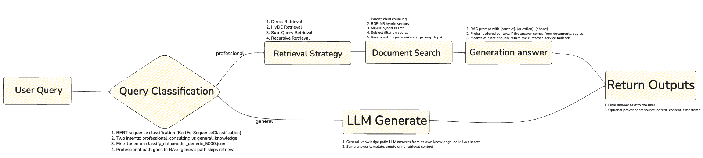
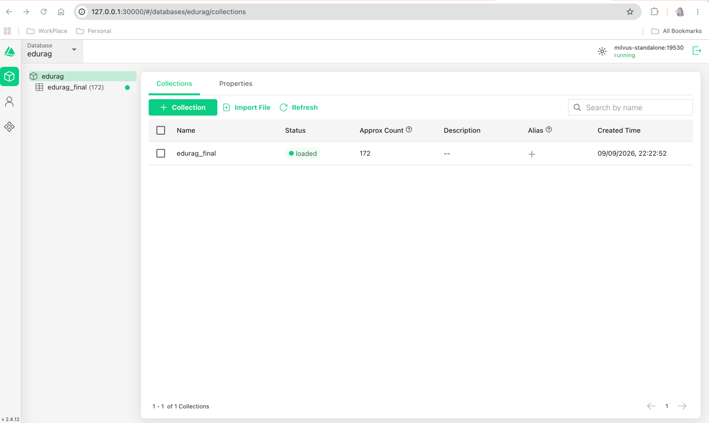
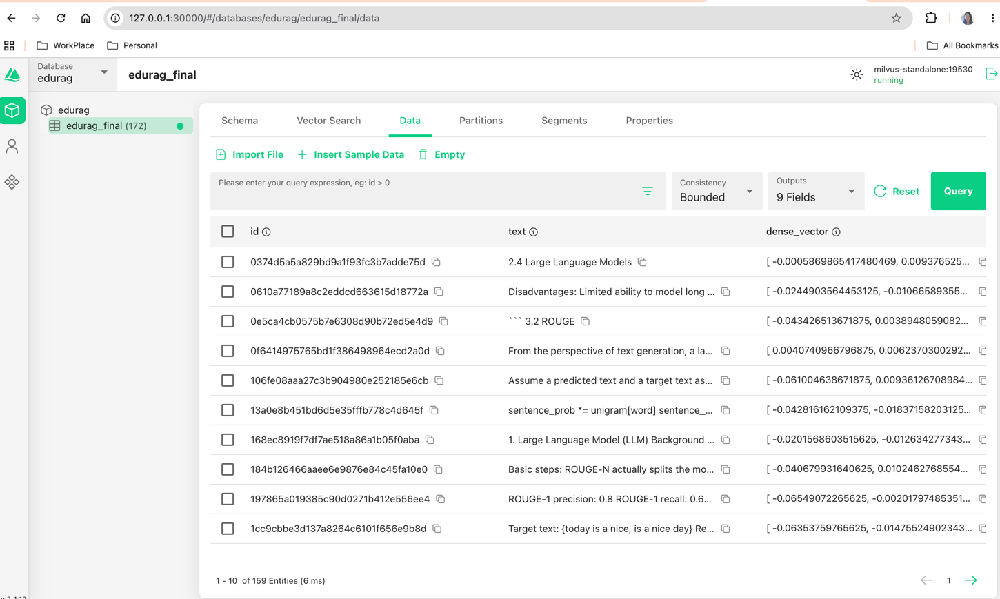
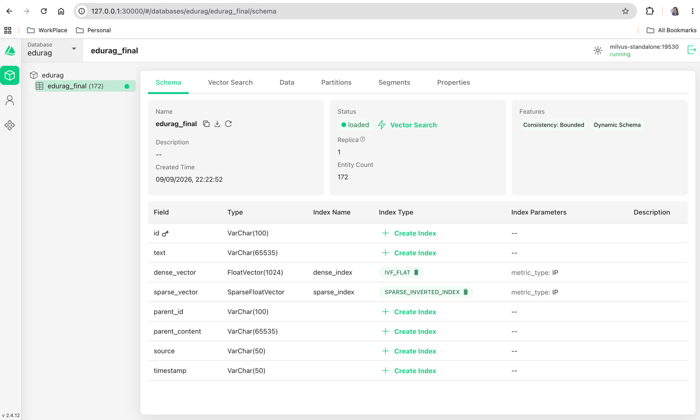
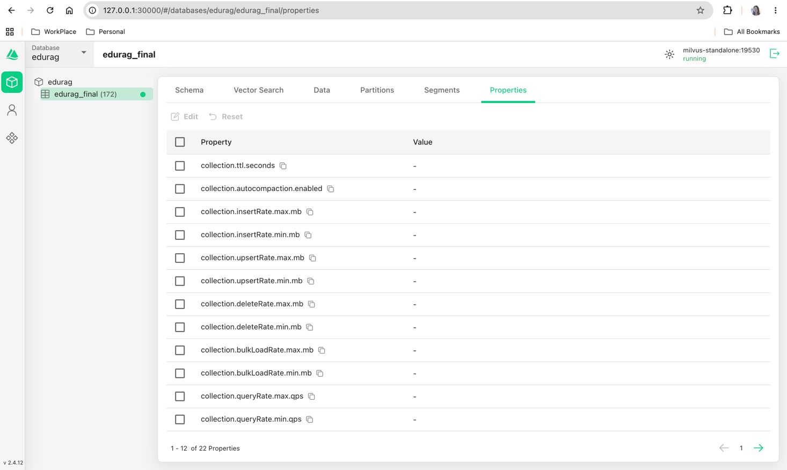

# Insurance RAG Assistant — retrieval notes

Online traffic is not “embed the question and return top-k”. I first classify whether this is claims adjudication, then pick a claims scene and a retrieval strategy, search clause / medical / case files, and generate a cited first-pass opinion from the parent context plus per-case history.

Code:

- `integrated_qa_system/rag_qa/core/query_classifier.py`
- `integrated_qa_system/rag_qa/core/strategy_selector.py`
- `integrated_qa_system/rag_qa/core/prompts.py`
- `integrated_qa_system/rag_qa/core/memory.py`
- `integrated_qa_system/rag_qa/core/rag_system.py`
- `integrated_qa_system/rag_qa/core/document_processor.py`
- `integrated_qa_system/rag_qa/core/vector_store.py`
- `integrated_qa_system/rag_qa/edu_text_spliter/`
- `integrated_qa_system/rag_qa/edu_document_loaders/`

<p></p>

---

## Online path: what I actually run

### Adjuster Query

1. Raw question is the only runtime input
2. The same string is reused for classification, scene routing, strategy selection, embedding, and rerank

### Query Classification

1. BERT sequence classification (`BertForSequenceClassification`)
2. Gate: `claims_adjudication` vs `general_inquiry`
3. Claims path goes to RAG; general inquiry skips retrieval
4. Claims scenes (LLM router): `document_audit` / `claims_rules` / `amount_calculation` / `policy_configuration`

### Retrieval Strategy

1. Direct Retrieval
2. HyDE Retrieval
3. Sub-Query Retrieval
4. Backtracking Retrieval

### Document Search

1. Parent-child chunking (`parent 1200` / `child 300`, overlap `50`) so legal sentences stay intact
2. BGE-M3 hybrid vectors: dense `1024` + sparse
3. Milvus hybrid search: `IVF_FLAT` + `SPARSE_INVERTED_INDEX`, `WeightedRanker(1.0, 0.7)`
4. Collection filter on `source` (`clause` / `medical` / `case`)
5. Deduplicate to parent docs, then rerank with `bge-reranker-large`, keep Top-M

### Conversation Memory

1. LangGraph `MemorySaver`, keyed by `thread_id = adjuster_{adjuster_id}_case_{case_id}`
2. One saver per agent type (`qa` / …) so State schemas do not clash
3. History is formatted as `User:` / `Assistant:` and injected into `{history}`
4. In-process today (lost on restart); swap to `AsyncPostgresSaver` for persistence
5. Two control strategies below keep the prompt from growing without bound

#### Two memory-control strategies

1. **Sliding window (deterministic truncation).** Keep only the most recent *n* turns; older turns are dropped immediately. The `SystemMessage` (system prompt) always stays at the front of the list and does not count toward the turn budget.
2. **Summary compression (semantic retention).** When the turn count exceeds a threshold, call the LLM to compress the older dialogue into a **case-profile summary** (insured facts, disputed clauses, unpaid amounts, unresolved questions). That summary replaces the discarded history so the semantically important facts remain.

### Generate Answer

1. Two answer templates: `rag_prompt()` uses `{context}`, `{question}`, `{phone}`; `rag_prompt_with_history()` also takes `{history}`
2. Prefer retrieved clauses / bills / cases; if the answer comes from documents, cite them
3. If context is not enough, return the claims-hotline fallback
4. After the opinion is produced, the turn is written back to `ConversationMemory`

### LLM Generate

1. General-inquiry path: LLM answers from its own knowledge, no Milvus search
2. Claims path: same template with retrieval context; `{history}` is still filled

### Return Outputs

1. Structured first-pass opinion to the adjuster
2. Provenance: `source`, `parent_content`, `timestamp`

---

## 1. Why dense-only RAG falls over on this corpus

The claims material I index is not web paragraphs. It is a mix of PDF policy wording, scanned bills, PPT medical guidelines, and Markdown case notes, heavy on legal and clinical jargon.

What actually breaks:

1. Scanned bills have no selectable text. Skip OCR and there is nothing to index.
2. An English recursive splitter cuts on `. ! ?`. Mixed-language clauses either never split or split in the wrong place.
3. Dense embeddings catch paraphrases. Queries that must hit the original term (a clause id, a deductible, an ICD code) drift.
4. Returning a 300-char hit is too thin. The match is local; later generation has no surrounding subsection.

So this is not `embedding + top-k`. I split the retrieval unit and the answer unit on purpose: **search on small chunks, return the parent as context**. Recursive sentence-aware splitting is what keeps legal text intact.

---

## 2. Stack (pipeline order, not a name dump)

| Stage | Choice | Role here |
| --- | --- | --- |
| Intent gate | Fine-tuned BERT | Route `general_inquiry` vs `claims_adjudication` |
| Claims scene | LLM router | document_audit / claims_rules / amount_calculation / policy_configuration |
| Strategy | LLM + `StrategySelector` | Direct / HyDE / Sub-query / Backtracking |
| Memory | LangGraph `MemorySaver` + `ConversationMemory` | Per-adjuster, per-case history; sliding window or summary compression |
| Prompts | `RAGPrompts` | Cited first-pass opinion, history-aware opinion, HyDE, sub-query, backtracking |
| Document object | LangChain `Document` | `page_content` + `metadata` through split, index, and recall |
| Loaders | Custom OCR loaders + LangChain loaders | `.pdf/.docx/.ppt/.pptx/.jpg/.png` → RapidOCR; `.txt/.md` → text loaders |
| OCR | RapidOCR (paddle first, onnxruntime fallback) | Text from bills and scans; CPU / GPU paths |
| Rule split | `EduRecursiveTextSplitter` | Recurse on sentence punctuation so clauses stay whole |
| Structure split | `MarkdownTextSplitter` | `.md` by headings / paragraphs, not punctuation |
| Semantic split (optional) | `AliTextSplitter` + ModelScope BERT segmentation | Spare path; not on the main ingest |
| Embedding | **BGE-M3** | One forward pass → dense (1024-d) and sparse |
| Vector DB | **Milvus 2.4 standalone** (pymilvus) | Both vector types in one collection; hybrid search |
| Dense index | IVF_FLAT + IP, `nlist=128`, search `nprobe=10` | Semantic neighbors |
| Sparse index | SPARSE_INVERTED_INDEX + IP, `drop_ratio_build=0.2` | Keyword inverted index for clause ids and terms |
| Fusion | `WeightedRanker(1.0, 0.7)` | Dense leads; sparse boosts exact terms |
| Rerank | **bge-reranker-large** (CrossEncoder) | Score deduped parents; keep Top-M |
| Primary key | MD5 of child text | `upsert`; re-ingest does not duplicate |
| Filter | `source` scalar | Cut search space by `clause` / `medical` / `case` |
| Device | MPS fp16 / CPU | Cast embeddings to `float32` before write or Milvus rejects them |

Defaults from `config.ini [retrieval]`:

- parent_chunk_size = **1200**
- child_chunk_size = **300**
- chunk_overlap = **50**
- retrieval_k = **5** (hybrid search returns 5 children)
- candidate_m = **2** (at most 2 parents after rerank)

---

## 3. Ingest: files → Document

`document_processor.load_documents_from_directory` walks the tree. Folder name `clause_data` becomes metadata `source = clause`. That field is the later filter (`clause` / `medical` / `case`).

Every successful load also sets:

- `file_path`
- `timestamp` (ISO)

A failed file logs an error and the rest of the directory still runs. One bad scan should not kill a whole corpus dump.

OCR is a fallback, not multimodal understanding. Blurry bills produce dirty text; dirty text poisons recall.
<p></p>
---

## 4. Chunk: parent / child, not one window

`process_documents` splits parents first, then children. Each child keeps the full parent:

```text
parent_id        = doc_{i}_parent_{j}
parent_content   = parent text
id               = {parent_id}_child_{k}
```

What gets indexed is the child. After a hit, `parent_content` rebuilds the parent; parents are deduped by that text.

Why I chose these sizes:

- Child 300: sharper vectors. Clause numbers, deductibles, and headings are easier for hybrid search to hit.
- Parent 1200: rerank (and later generation) see a full subsection, not half a sentence — required for legal completeness.
- Overlap 50: sentences on the window edge still line up across adjacent children.

`.md` uses `MarkdownTextSplitter`. Everything else uses `EduRecursiveTextSplitter`. The recursive splitter walks paragraph → sentence → clause → comma until something actually cuts, then collapses extra blank lines. Separators stay in the chunk (`keep_separator=True`), so sentence punctuation is not stripped.

`AliTextSplitter` is in the package and not wired into the main path. Semantic splits follow paragraph boundaries better, but they pull in a BERT and are slow on CPU. Claims files currently use rule-based splits; semantic split is a spare option.
<p></p>
---

## 5. Index: BGE-M3 + two vector fields in Milvus

Collection: `edurag.edurag_final` (Insurance RAG Assistant vector store). The database is created if missing.

Fields that actually affect retrieval:

| Field | Type | Use |
| --- | --- | --- |
| id | VARCHAR PK | child MD5 |
| text | VARCHAR | child body |
| dense_vector | FLOAT_VECTOR(1024) | BGE-M3 dense |
| sparse_vector | SPARSE_FLOAT_VECTOR | BGE-M3 term weights as `{index: weight}` |
| parent_id / parent_content | VARCHAR | rebuild parent after a hit |
| source | VARCHAR | `clause` / `medical` / `case` filter |
| timestamp | VARCHAR | provenance |

One BGE-M3 encode gives dense and sparse, so there is no separate BM25 corpus to keep in sync. Sparse index build drops the bottom 20% of weights; the inverted list is cleaner on function words in forms.

Writes go through `upsert`. Re-running `vector_store.py` on the same files overwrites identical children instead of appending.

On Mac MPS, embeddings default to fp16. Milvus FLOAT_VECTOR wants `float32`. `add_documents` does `np.asarray(..., dtype=np.float32)` and casts sparse index/value to Python `int` / `float`. That is a real type error, not a style choice.
<p></p>
---

## 6. Retrieve: hybrid → parent dedupe → CrossEncoder

`hybrid_search_with_rerank(query, k=5, source_filter=...)`:

1. Encode the query with BGE-M3 → dense + sparse.
2. Two `AnnSearchRequest`s share the same filter, e.g. `source == 'clause'`.
3. Milvus `hybrid_search` + `WeightedRanker(1.0, 0.7)`: dense owns semantics, sparse pulls the original term back.
4. Map children to parents; dedupe on `parent_content`. Several child hits in one section collapse to one parent.
5. Fewer than 2 parents: skip rerank, slice to `candidate_m`.
6. Otherwise `bge-reranker-large` scores `[query, parent_content]`, sort descending, keep Top-2.

Rerank runs on parents, not children. A CrossEncoder is more accurate than a bi-encoder and more expensive, so it only sees the short fused list, not the whole collection.

`vector_store.py` can ingest and then run a sample hybrid search. Generation consumes the same parent list as citations.
<p></p>

---

## 7. Where I patch each kind of recall error

1. **Parse.** No text on the bill → OCR first, or the rest of the stack is idle.
2. **Split.** Sentence punctuation recursion + Markdown structure. Parent/child separates retrieval grain from answer grain so clauses stay complete.
3. **Route.** BERT decides whether this query even needs the corpus; the scene router picks clause vs medical vs case.
4. **Rewrite.** Strategy selector picks Direct / HyDE / Sub-query / Backtracking before search.
5. **Represent.** BGE-M3 emits dense and sparse in one pass: paraphrase and exact term.
6. **Index.** IVF_FLAT for semantics, inverted index for jargon, scalar `source` to drop other collections first.
7. **Rank.** Weighted fusion only mixes the two recall lists. Final order is the CrossEncoder.

- Why not ColBERT multi-vector?
* BGE-M3 can emit `colbert_vecs`;

- Parameters: 1200 / 300 / 50 are working values.
- Too little overlap drops sentences;
- too large a parent adds noise for the reranker.
- `WeightedRanker` 1.0 / 0.7 can move with how term-heavy the queries are.

---

## 8. Conversation memory: bound the history, keep the signal

`memory.py` stores turns in a LangGraph checkpointer. `rag_system.query()` loads `{history}` before generation and appends the new Q&A after it. Without a bound, long cases blow the context window and drown the current question in old chat.

I use two complementary controls:

1. **Sliding window (deterministic truncation).** Keep only the latest *n* turns; anything older is discarded. Cheap and predictable. The `SystemMessage` (system prompt) is pinned at the front and excluded from the turn count, so adjudication policy never falls out of the prompt.
2. **Summary compression (semantic retention).** When the turn count crosses a threshold, the LLM compresses the older dialogue into a case-profile summary (goals, constraints, names, disputed clauses, unpaid amounts). The summary replaces the dropped turns. You lose verbatim chat, not the facts that later opinions still need.

The window is the default for short cases. Compression kicks in when *n* is not enough and dropping history would lose the case state.

Code: `integrated_qa_system/rag_qa/core/memory.py`, consumed by `rag_system.py` and `rag_prompt_with_history()`.

---
