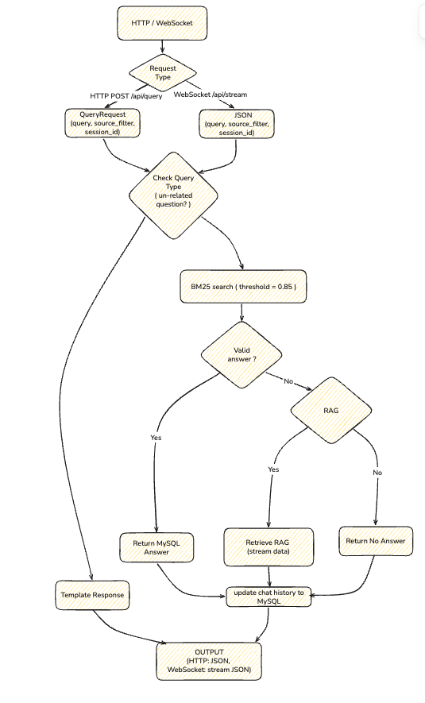
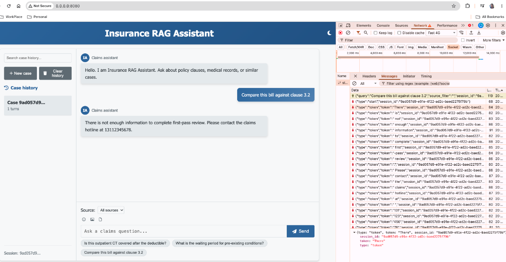
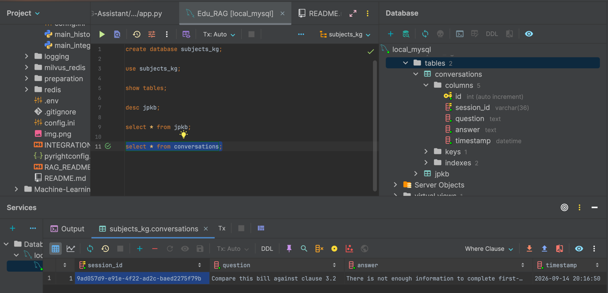
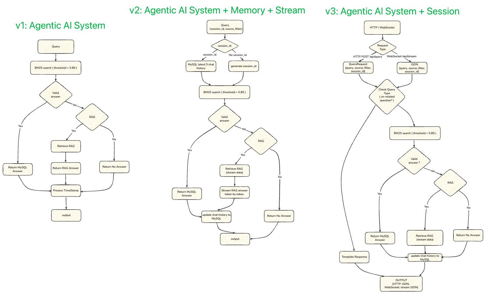

# Insurance RAG Assistant

**Health Insurance Claims Retrieval-Augmented Generation System**

Insurance RAG Assistant is an intelligent claims-assist platform that turns first-pass review, clause matching, and opinion drafting from a two-day manual grind into a four-hour, AI-backed workflow.

This repository is that system: ingest policy clauses, medical guidelines, and historical case files; route the adjuster's question; retrieve with dense + sparse hybrid search; generate a cited first-pass opinion; keep per-case memory.

## Tech Stack

| Layer | Stack                                                                           |
| --- |---------------------------------------------------------------------------------|
| Language & serving | Python, FastAPI (HTTP FAQ hits + WebSocket token stream) |
| Vector database | Milvus (multi-collection isolation via `source`: clause / medical / case) |
| Intent routing | Fine-tuned BERT (claims vs general) + 4-class claims scene router |
| Hybrid retrieval | BGE-M3 dense + sparse dual recall, weighted fusion, domain reranker |
| Generation | OpenAI-compatible chat model supplied at runtime |
| Evaluation | RagAS-style metrics: context relevance, answer faithfulness, retrieval hit rate |
| Memory | MySQL `conversations` keyed by `session_id` (last 5 turns); LangGraph `MemorySaver` in Version 1 CLI |
| Cache / structured QA | Redis, MySQL, BM25 |
| Runtime | Docker (Milvus, Redis, Attu), LangChain |

## Business Challenges

Health-insurance claims were slow and inconsistent: dense policy language, unstructured medical bills, and no shared adjudication standard. Adjusters spent days on first-pass review, clause interpretation drifted across desks, and cycle time plus compliance risk both went up.

## What It Does

1. **Knowledge & index.** Cleaned and structured 150K+ heterogeneous claims records (clauses, medical guidelines, historical case files). Recursive sentence-aware splitting keeps legal text intact. Milvus isolates clause / medical / case collections for cross-domain joint search.
2. **Intent routing & hybrid recall.** BERT gates claims adjudication vs general inquiry. Claims traffic is routed into four scenes: **document audit**, **claims rules**, **amount calculation**, **policy configuration**. Dense + sparse dual recall, then fusion + a domain reranker, lifts recall on long clauses and messy bills.
3. **Cited generation.** Domain prompts strengthen adjudication reasoning and compliant wording. Dynamic prompt assembly plus retrieved clause citations produces a structured, explainable first-pass opinion and cuts hallucination / clause-misread risk.
4. **Closed-loop evaluation.** Track context relevance, answer faithfulness, and retrieval hit rate. Bad-case analysis feeds retrieval and prompt iteration.

## Business Impact

| Pain | Result |
| --- | --- |
| Slow first-pass review | **75%** of first-pass work automated; average case time **2 days → 4 hours** |
| Inconsistent clause interpretation | System-assisted decision accuracy **91%**; consultation satisfaction **+40%** |
| No measurable RAG quality | Evaluation loop keeps retrieval and generation under quantitative control |

## Runtime path

```text
adjuster query
  → BERT: general_inquiry | claims_adjudication
  → claims scene: document_audit | claims_rules | amount_calculation | policy_configuration
  → retrieval strategy: Direct | HyDE | Sub-query | Backtracking
  → BGE-M3 hybrid search (filter source = clause | medical | case)
  → parent dedupe + rerank
  → generate with {history} + {context} + citations
  → stream tokens to the FastAPI UI
  → INSERT the turn into MySQL `conversations` (`session_id`)
```

Deeper retrieval notes: [`RAG_README.md`](./RAG_README.md). CLI + stream wiring: [`INTEGRATION_README.md`](./INTEGRATION_README.md).

---

## Setup

All commands below assume you start from the `Insurance-RAG-Assistant/` directory.

### 1. Install Dependencies

```bash
pip install -r requirements.txt
```

### 2. Start Milvus, Redis, and Attu

Docker Compose starts **Attu v2.4.12** (GUI for Milvus 2.4.x) with the rest of the stack.

Do **not** run `docker pull zilliz/attu` or `docker run zilliz/attu` separately. The untagged `latest` image is Attu v3, which shows an email/password login page and does **not** support this project's Milvus 2.4.4.

If you previously started Attu that way, stop and remove it first so port `30000` is free:

```bash
docker ps -a --filter ancestor=zilliz/attu
docker stop <container_id>
docker rm <container_id>
```

Then start the stack:

```bash
cd milvus_redis
docker compose up -d
```

Wait until the containers are healthy, then confirm they are running:

```bash
docker ps
```

The following services should be `Up`:

| Container           | Image                    | Host port | Purpose              |
|---------------------|--------------------------|-----------|----------------------|
| `milvus-standalone` | `milvusdb/milvus:v2.4.4` | private   | Milvus gRPC          |
| `milvus-attu`       | `zilliz/attu:v2.4.12`    | private   | Attu web UI          |
| `milvus-redis`      | `redis:latest`           | private   | Redis |
| `milvus-minio`      | MinIO                    | (internal)| Object storage       |
| `milvus-etcd`       | etcd                     | (internal)| Metadata             |

<p></p>

When you are finished, shut the stack down from the same directory:

```bash
cd milvus_redis
docker compose down
```

### 3. Open Attu and Connect to Milvus

Open the Attu port from your private runtime configuration.

You should see **Connect to Milvus Server** (not an email/password form). The Milvus address, database name, and authentication flag come from that same private configuration. Use the Docker-network address for Milvus, not the Attu container's own loopback.

If the page still shows email/password, hard-refresh the browser (`Cmd+Shift+R`) or try a private window. The old Attu v3 page is often cached.

<p></p>

### 4. Test Milvus and Redis from Python

From `Insurance-RAG-Assistant/`:

```bash
python milvus_redis/test_milvus.py
```

A successful run prints the Milvus version and a Redis value, for example:

```text
Milvus version: v2.4.4
Redis value: Hello, Redis!
```

<p></p>

The test script reads the Milvus and Redis connection settings from the private runtime configuration.

### 5. Access Attu from Another Device on the Same Network (Optional)

This is only needed if you want to open Attu from a phone or another computer. On a Mac, get this machine's LAN IP:

```bash
ipconfig getifaddr en0
```

Then open the Attu port on that address. The Connect address in Attu stays the Docker-network Milvus address from the private runtime configuration.

### 6. Milvus schema

Collections are filtered by `source`: `clause` (policy language), `medical` (bills / guidelines), `case` (historical adjudications).

<p></p>

### 7. Run the Insurance Assistant UI

<p></p>

FastAPI is the serving layer for the running system. `POST /api/query` returns a full answer when BM25 hits a canned FAQ; when RAG is needed, the UI opens WebSocket `/api/stream` and renders the first-pass opinion token by token.

```bash
cd integrated_qa_system
python app.py
```

Open the host and port from the private runtime configuration.

<p></p>

Each browser case is a `session_id` (UUID from **New case**). After every turn the system inserts `(session_id, question, answer, timestamp)` into MySQL `conversations`, keeps the latest five rows for that session, and injects them as `{history}` on the next question. **Clear history** deletes only that session's rows.

<p></p>

### Getting stronger
<p></p>