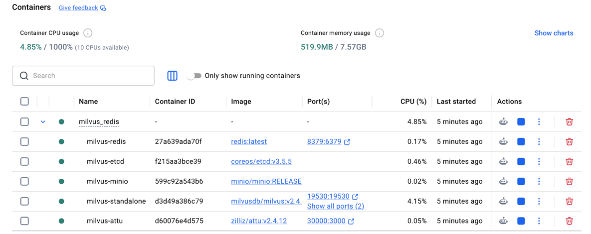
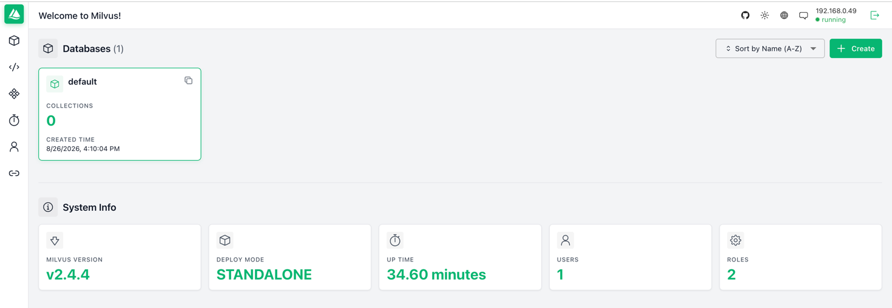
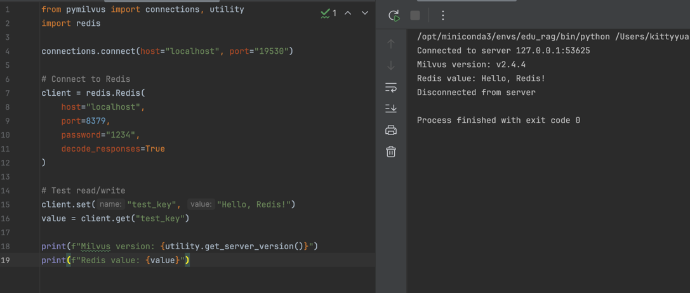
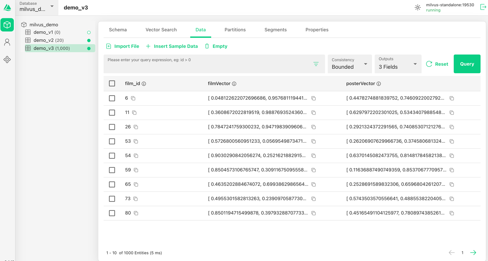

# Educational Assistant System

An intelligent educational question-answering system built with the following technologies:

- Python
- RAG
- Milvus
- Redis
- LLM
- Docker
- LangChain
- MySQL
- BM25
- FastAPI

## Setup

Follow these steps in order. All commands below assume you start from the `Edu-Assistant/` directory.

### 1. Create the Conda Environment

```bash
conda create -n edu_rag python==3.10.18
conda activate edu_rag
```

### 2. Install Dependencies

```bash
pip install -r requirements.txt
```

### 3. Start Milvus, Redis, and Attu

Docker Compose now starts everything together, including **Attu v2.4.12** (the GUI for Milvus 2.4.x).

Do **not** run `docker pull zilliz/attu` or `docker run zilliz/attu` separately. The untagged `latest` image is Attu v3, which shows an email/password login page and does **not** support this project's Milvus 2.4.4.

If you previously started Attu that way, stop and remove it first so port `30000` is free:

```bash
docker ps -a --filter ancestor=zilliz/attu
docker stop <container_id>
docker rm <container_id>
```

Then start the stack:

```bash
cd milvus_redis
docker compose up -d
```

Wait until the containers are healthy, then confirm they are running:

```bash
docker ps
```

The following services should be `Up`:

| Container           | Image                    | Host port | Purpose              |
|---------------------|--------------------------|-----------|----------------------|
| `milvus-standalone` | `milvusdb/milvus:v2.4.4` | `19530`   | Milvus gRPC          |
| `milvus-attu`       | `zilliz/attu:v2.4.12`    | `30000`   | Attu web UI          |
| `milvus-redis`      | `redis:latest`           | `8379`    | Redis (password `1234`) |
| `milvus-minio`      | MinIO                    | (internal)| Object storage       |
| `milvus-etcd`       | etcd                     | (internal)| Metadata             |

<p></p>

When you are finished, shut the stack down from the same directory:

```bash
cd milvus_redis
docker compose down
```

### 4. Open Attu and Connect to Milvus

Open **http://127.0.0.1:30000/** in your browser.

You should see **Connect to Milvus Server** (not an email/password form). Use these values:

- **Milvus Address:** `milvus-standalone:19530` (already pre-filled)
- **Milvus Database:** `default`
- **Authentication:** leave **off**
- Click **Connect**

`milvus-standalone:19530` is the address inside the Docker network. Do not use `127.0.0.1:19530` in Attu; that address points at the Attu container itself, not Milvus.

If the page still shows email/password, hard-refresh the browser (`Cmd+Shift+R`) or try a private window. The old Attu v3 page is often cached.

<p></p>

### 5. Test Milvus and Redis from Python

Stay in the `edu_rag` environment. From `Edu-Assistant/`:

```bash
python milvus_redis/test_milvus.py
```

A successful run prints the Milvus version and a Redis value, for example:

```text
Milvus version: v2.4.4
Redis value: Hello, Redis!
```

<p></p>

The test script connects with:

- Milvus: `localhost:19530`
- Redis: `localhost:8379`, password `1234`

### 6. Access Attu from Another Device on the Same Network (Optional)

This is only needed if you want to open Attu from a phone or another computer. On a Mac, get this machine's LAN IP:

```bash
ipconfig getifaddr en0
```

Then open `http://<your-lan-ip>:30000` on the other device. The Connect address in Attu is still `milvus-standalone:19530`.

### 7. Milvus db schema
<p></p>
